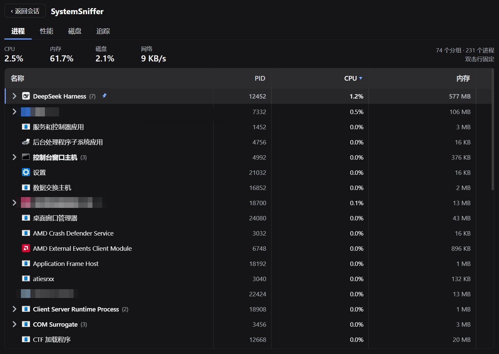
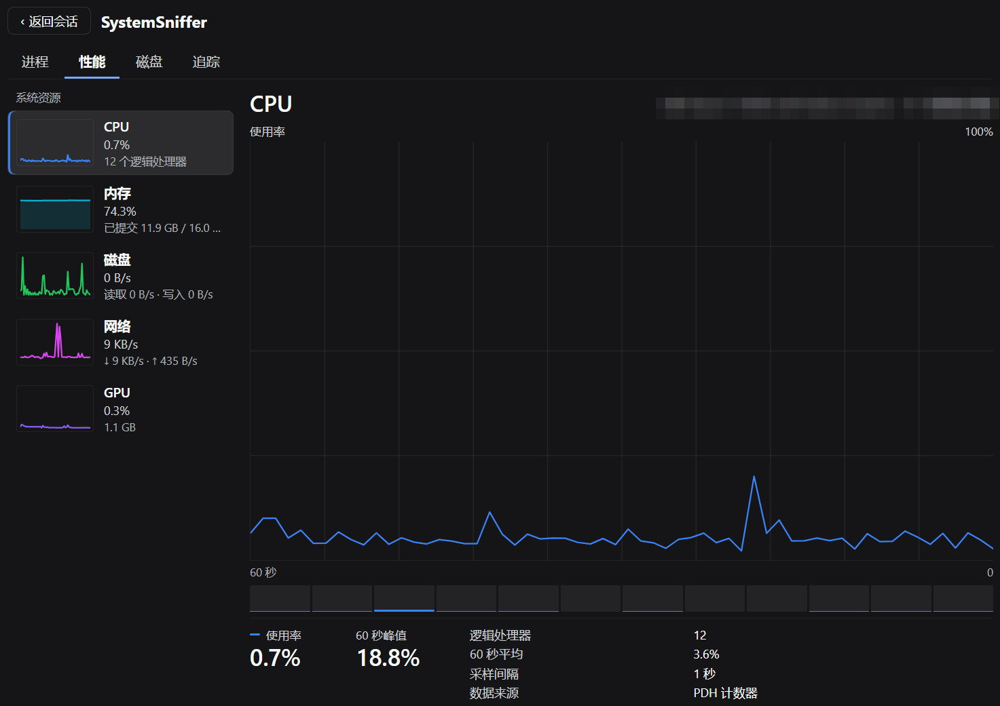
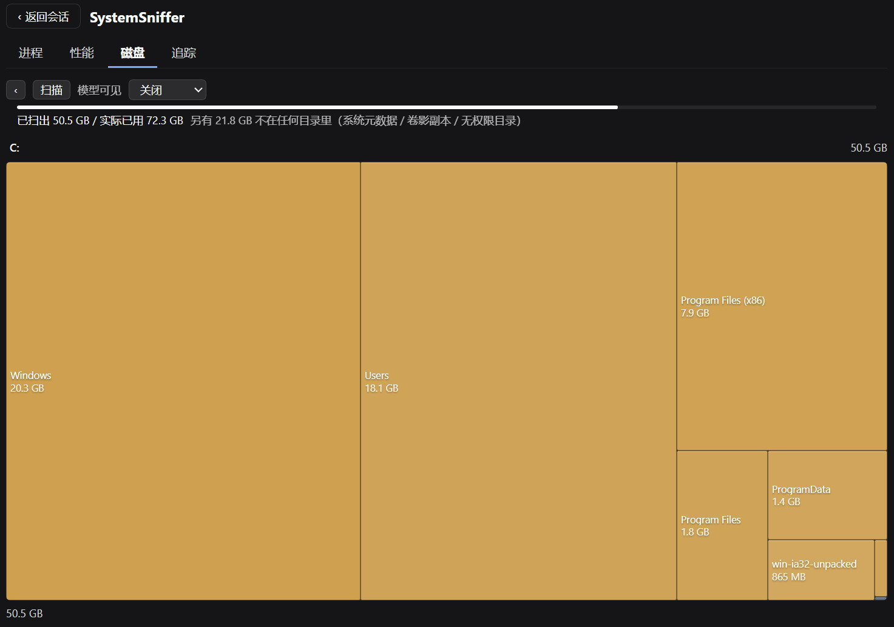
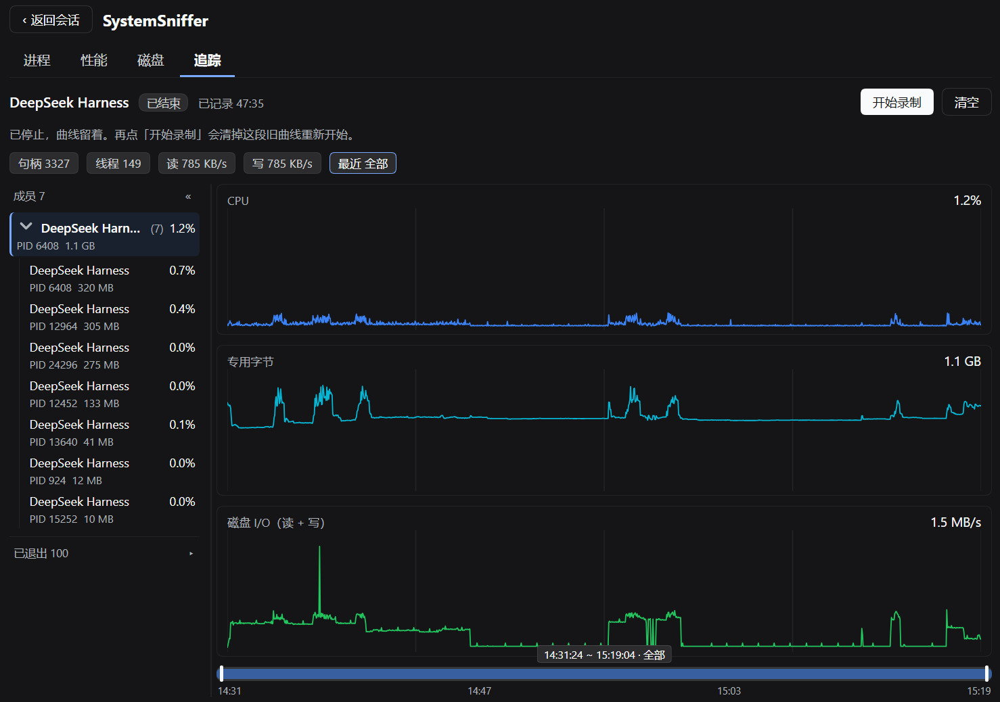

# System Sniffer

Windows 系统面板：**进程 · 性能 · 磁盘 · 追踪**四个页签，外加一个模型可调用的 `system_sniff`
工具。面板与工具读同一套采集层，两处的数字口径一致。

界面目前只有中文。

## 进程



按应用分组的整页表格，每秒一拍。

- 同名同 exe 的进程折成一组，组行是成员求和，`(7)` 是组里的进程数；点 chevron 展开成员，
  成员有自己的图标与文件说明（`Google Chrome` 而不是 `chrome`）
- 四列：名称 / PID / CPU / 内存。内存是**专用工作集**，与任务管理器「内存」列同口径，不含
  共享 DLL 页
- 点表头在名称 / PID / CPU / 内存之间切换排序；拖表头右缘改列宽，松手后记住
- 双击一行置顶（最多 5 个）；钉住的进程退出后留一行灰色「已退出」
- 表头上方一条总数值带：CPU%、内存已用占比、磁盘活动时间%、网络合计速率

## 性能



与任务管理器同构：左列五张卡（CPU / 内存 / 磁盘 / 网络 / GPU），右侧是选中那张的 60 秒走势与
明细。

- CPU：整机占用 + 逐逻辑处理器占用条，副标题是 CPU 型号
- 内存：**已提交 / 提交上限**，不是「物理内存占用」；物理可用在右侧明细里
- 网络：所有接口之和；接口多于一个时按接口分行给 IPv4 / IPv6
- 没有对应计数器时（如虚拟机没有 GPU）显示「本机没有计数器」，而不是 0
- 图上的空档是真的没采到数据，不会连成直线

## 磁盘



各卷已用 / 总量、占用条（≥75% 警告色、≥90% 错误色）、剩余容量。

- 「扫描」是独立 job：选一个卷根，Host 遍历目录并按大小画方块图，可逐层下钻、可取消；顶部
  写清「已扫描 / 实际已用」，差额是系统元数据、卷影副本与无权限目录
- 「模型可见」下拉控制磁盘数据对 `system_sniff` 的开放级：关闭（默认）/ 数字 / 目录名；任何
  一级都不含路径与文件名

## 追踪



右键进程页的一个组（或单个进程）→ 直接进**预览**：当拍就有曲线，但只留 5 秒，没人看就丢。

- 点「开始录制」才留下历史，最长 8 小时（内存环，不落盘）；面板收起也继续记，回会话后右上角
  有「● 正在记录」徽标
- 右侧三张大图共用一条真实时间轴：CPU · 专用字节 · 磁盘 IO（读+写）
- 左侧成员栏给名字 / CPU / 内存；退出的成员留灰行「已退出 HH:MM:SS」
- 底部范围条是整环缩影：两端拖改范围、中段平移、点空白跳过去，两端拉到头是「全部」

## 模型侧：`system_sniff`

返回 cpu / memory / gpu / volume / network / processes 的当前值，每段带自己的 `sampledAt`；
参数是 `include` 列表与 `top N`（1–30，默认 8）。它只给数据，不下结论。

## 运行要求

- DeepSeek Harness **Desktop 0.2.2-rc.3 及以上**（在 0.2.2-rc.5 上验证）。**只在桌面端测过**，
  浏览器里的 Web 端没测
- **Windows 10/11 x64**。采集走 PDH 计数器（`pdh.dll`）与 `NtQuerySystemInformation`，都是
  Windows 专有；macOS / Linux / ARM 上装得进去，但面板没有数据
- 中文或英文 Windows：原生路径用 `PdhAddEnglishCounterW`，不受系统语言影响；只有回退到
  `typeperf` 的路径仍依赖本地化计数器名
- Node.js 仅用于安装依赖与跑测试

## 安装

插件不在 npm 上，装的是本地目录：

1. `git clone https://github.com/Andra0-0/dsh-system-sniffer.git` 到一个**固定目录**（之后不要挪，
   设置里记的是这个路径）
2. 在该目录 `npm install`。确认这两个目录都在：
   - `node_modules/koffi`
   - `node_modules/@koromix/koffi-win32-x64`（koffi 的原生包，`optionalDependencies`；
     只复制 `koffi` 会报 `Cannot find the native Koffi module`）

   koffi 的安装脚本会尝试走 `cnoke --prebuild`；没有编译环境或下载失败时，用
   `npm install --ignore-scripts` 也能装成——原生 .node 就在 `@koromix` 那个包里。
3. 打开 DSH → **插件 → 添加插件**（Add plugin）→ 选这个目录
4. 启用 bundle，然后**重启 DSH**（客户端模块要新的一代才会载入）
5. 左栏出现「系统」一行；点开就是整页面板；模型侧出现 `system_sniff`
6. 卸载：插件页移除 bundle → 删掉配置文件里对它的依赖 → 删目录

## 隐私

只在本机采集，**没有任何网络请求**：

- 读：进程名 / PID / CPU / 专用工作集 / 句柄 / 线程 / IO、卷容量、GPU 计数器、网卡速率
- **不读**：用户名、进程命令行、窗口标题、exe 完整路径（面板下发与工具返回里都没有）
- 追踪只写内存（8 小时环，约 1.4 MB），关闭 DSH 即丢
- 磁盘扫描只读，模型可见默认 **关闭**；开启后最多给到目录名（≤10 个），任何档位都不含路径
  与文件名
- 唯一会碰磁盘的写操作：无（调试期的 `%TEMP%` 诊断文件已删除）

## 配置

`cordis.patch.yml` 里可以改这些键：

| 键 | 默认 | 说明 |
|---|---|---|
| `keepWarm` | `false` | 仅影响 `typeperf` 回退组：保留常驻子进程 |
| `procCollector` | `native` | 设为 `typeperf` 可强制进程表走 typeperf 回退 |
| `pdhSource` | `native` | 设为 `typeperf` 可强制三组 PDH 计数器走 typeperf |
| `warm` | `true` | 插件激活即预热 cpu / memory / network / gpu / diskio |
| `diskTool` | `off` | 磁盘扫描对模型的可见级：`off` / `numbers` / `names` |
| `sections` / `groups` | — | 覆盖段表与计数器组（内部表，不建议改） |

**预热是有意的**：插件激活后常驻一个采集子进程（实测私有内存约 23 MB），换来打开面板首帧
就有数。关掉面板后 `processes` 与 `volumes` 会在 30 秒后退休，但 cpu / memory / network /
gpu / diskio 五段保持常驻——它们正是首帧的来源。`warm: false` 可以取消预热。

本插件不导出 `Config` schema：配置写在 `cordis.patch.yml` 里、重启生效，面板里改的磁盘扫描
可见级只在当前会话有效。

## 已知限制

- 进程表 1 秒一拍，存活短于 1 秒的进程看不到
- UWP 应用的归属按可执行文件与窗口宿主推断，个别会归错组
- 没有 GPU 计数器（Win10 1709 之前、部分虚拟机）时 GPU 卡显示「本机没有计数器」而不是 0
- 磁盘扫描不跟进 UNC 路径与 `\\?\Volume{}` 挂载点
- 原生采集失效时会回退 `typeperf`：数字口径一致，但回退路径下追踪页的组目标拿不到 `appId`，
  曲线会没有点

## 开发

`client.js` 是手写单文件（约 6000 行），没有构建步骤；Host 侧是 `index.js` + `lib/`，原生采集
在 `native/`（子进程，koffi 直调 Win32）。

```powershell
npm install       # 测试用的 devDependencies（react / react-dom / jsdom）
npm test          # = node test/run.mjs，11 个测试文件，约 6 秒
npm run check     # 语法检查
```

测试分两层：

- `test-client-render.mjs` 用 **jsdom + 真 React** 挂载整页面板：四个页签、默认停在进程页、
  点击切页签、卸载后停止轮询
- `test-client-boot.mjs` 用假 React 走一遍组件树（不需要 DOM），并在末尾用假 `document` +
  可控 `fetch` 单独验证轮询：每个请求都带 abort signal、失败会上报并自愈、dispose 后停

- `docs/DESIGN.md`：为什么这样分层（段模型、租约、原生优先 + typeperf 兜底）
- `docs/DETAIL.md`：面板与追踪的详细行为
- `docs/PITFALLS.md`：31 条实测踩坑（PDH / koffi / 图标 / IPC）

## License

MIT。依赖 [koffi](https://koffi.dev/)（MIT）。
