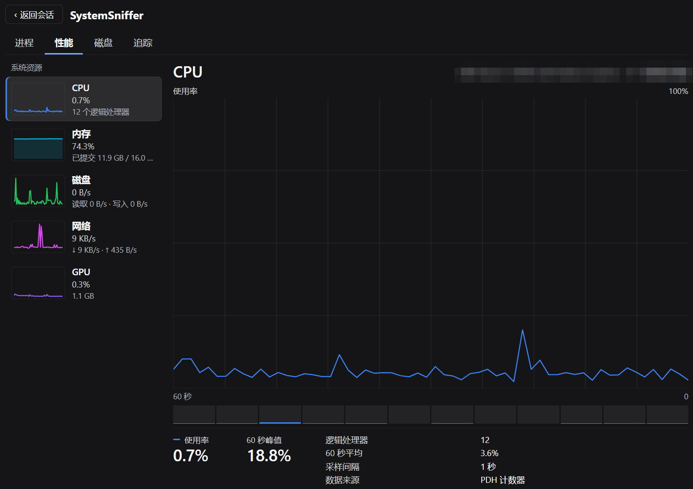
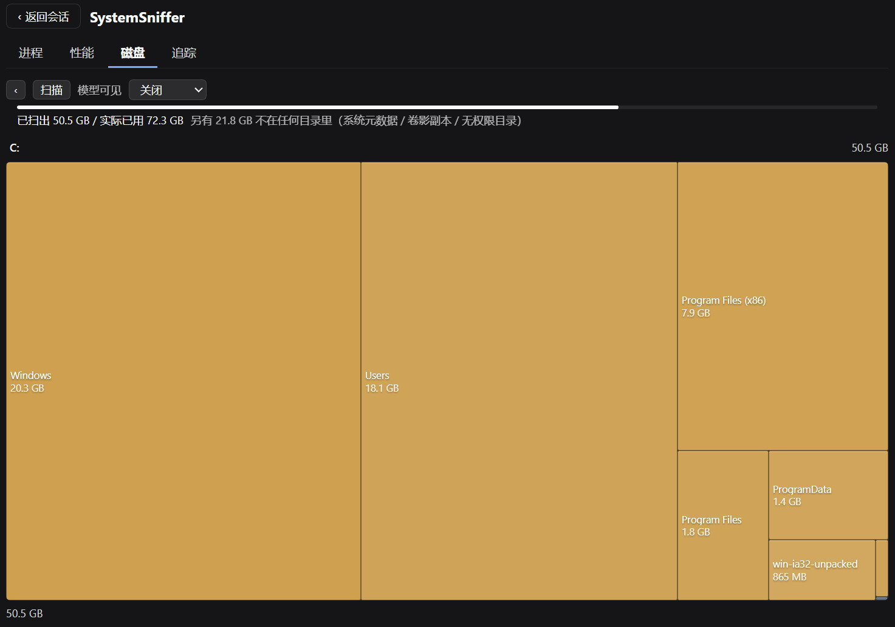
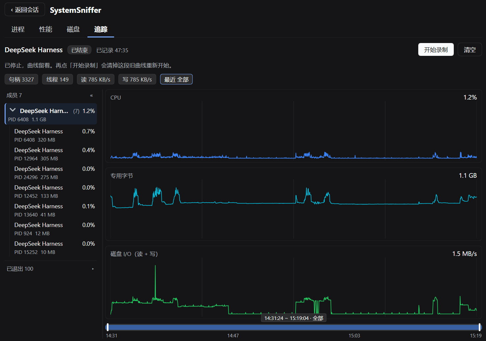

# 面板行为

左栏「系统」→ 整页面板。顶部是「‹ 返回会话」+ 标题 `SystemSniffer`，下面四个页签：
**进程 · 性能 · 磁盘 · 追踪**。打开时默认停在**进程**页：原生采集 ~130 ms 就有第一份名单，
CPU 列在第二拍（1 秒）补上；性能页再也不是唯一"首屏有数"的页，而进程表才是打开这个面板的
主要目的。

## 进程

整页表格，每秒一拍，默认按 CPU 降序；组数不设上限，有多少组列多少组。

- **按应用分组**：同名同 exe 的进程折成一组，组行是成员求和；`(N)` 是组里的进程数
- **列**：名称 · PID · CPU · 内存。内存是**专用工作集**（任务管理器「内存」列的口径，不含
  共享 DLL 页），不是总工作集
- **排序**：点表头在名称 / PID / CPU / 内存之间切换，箭头指方向
- **列宽可拖**：表头右缘 9 px 手柄，拖过之后四列锁成像素宽度并记住
- **置顶**：双击一行钉住，最多 5 个；钉住的进程退出后留一行灰色「已退出」
- **展开**：组行左侧的 chevron 展开成员，成员有自己的图标与 FileDescription（`Google Chrome`
  而不是 `chrome`），与本组 exe 不同的再后缀一个灰色 exe 名

表头上方是一条总数值带：CPU%、内存已用占比、磁盘活动时间%、网络合计速率。

## 性能

左列五张可选卡（CPU / 内存 / 磁盘 / 网络 / GPU），右侧是选中那张的大图。

- 大图：标题 + 右上角量程 + `60 秒 → 0` 时间轴，图下是主读数与明细
- CPU：整机占用 + 逐逻辑处理器占用条，副标题是 CPU 型号
- 内存：**已提交 / 提交上限**，不是「物理内存占用」——物理可用在右侧明细里
- 磁盘：读 / 写速率 + 活动时间，容量在磁盘页
- 网络：所有接口之和；接口多于一个时标题写「吞吐量（N 个接口合计）」，明细按接口分行给
  IPv4 / IPv6
- 没有对应计数器时（如虚拟机没有 GPU）写「本机没有计数器」，不是 0
- 切走面板再回来同一张卡；图上的空档是真的没采到数据，不会连成直线

## 磁盘

各卷已用 / 总量、占用条（≥75% 警告色、≥90% 错误色）、剩余容量。

「扫描」是独立 job：选一个卷根，Host 遍历目录并按大小画方块图，可逐层下钻、可取消；顶部写
清「已扫描 / 实际已用」，差额是系统元数据、卷影副本与无权限目录。扫描不跟进 UNC 路径与
`\\?\Volume{}` 挂载点。

「模型可见」下拉是磁盘数据对 `system_sniff` 的开放级：关闭（默认）/ 数字 / 目录名。任何一级
都不含路径与文件名。

## 追踪

右键进程页的一个组（或单个进程）→「追踪此组」进入追踪页。

- 进去就是**预览**：灰 chip + 计时，曲线当拍就有数，但不留历史
- 点「开始录制」才留下历史，面板收起也继续记，最长 8 小时（内存环，不落盘）
- 点「停止追踪」冻结曲线；点「清空」连目标一起丢
- 左侧成员栏：名字 / CPU / 内存；退出的成员留灰行「已退出 HH:MM:SS」
- 右侧三张大图共用一条真实时间轴：CPU · 专用字节 · 磁盘 IO（读+写）
- 最下面的范围条：整环缩影 + 当前窗口的拇指，两端可拖改范围、中段拖动平移、点空白跳过去；
  两端都拉到头是「全部」
- 录制中回会话，右上角有「● 正在记录」徽标，点一下回来

预览 5 秒没人看就丢（环清空、目标保留）；录制只有用户停止或清空才结束。

## 采样与寿命

- 面板每秒请求一次当前页签需要的段，带游标增量读取，Host 记住最近 60 秒
- 插件激活即预热 cpu / memory / network / gpu / diskio（常驻，见 README「配置」）
- `processes` 与 `volumes` 有 30 秒租约：离开页面 30 秒后停采，回来第一拍就恢复
- 浏览器被杀掉留下的租约由 120 秒 TTL 清理
- 首个样本前：卡片显示 `—`，进程表写「暂无进程数据，正在等待首个样本」，不出现骨架屏

## 数字口径

| 项 | 口径 |
|---|---|
| CPU | 整机 `% Processor Time`，与任务管理器相差约 ±1% |
| 内存 | 已提交 / 提交上限；物理可用在明细 |
| 进程内存 | 专用工作集（Private Working Set） |
| 进程 CPU | 每秒差分，按逻辑处理器数归一化 |
| 网络 | 所有 PDH 接口实例的收 + 发，含回环与虚拟网卡 |
| GPU | `GPU Engine` 利用率与 `GPU Adapter Memory` 专用显存，多引擎取和 |
| 磁盘 | 物理磁盘读写速率与活动时间；容量在磁盘页 |

## 截图

